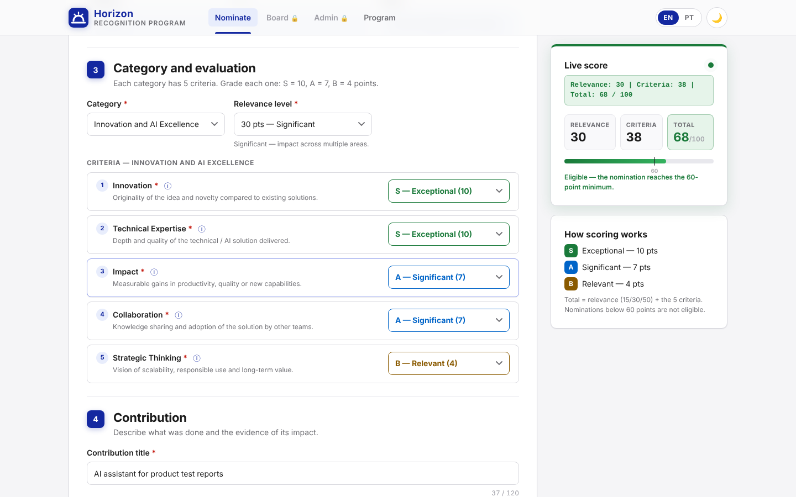
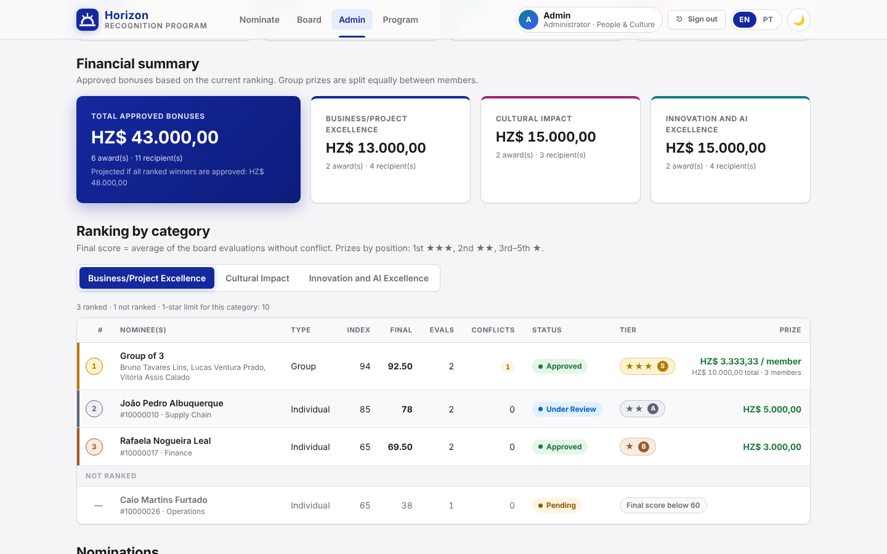
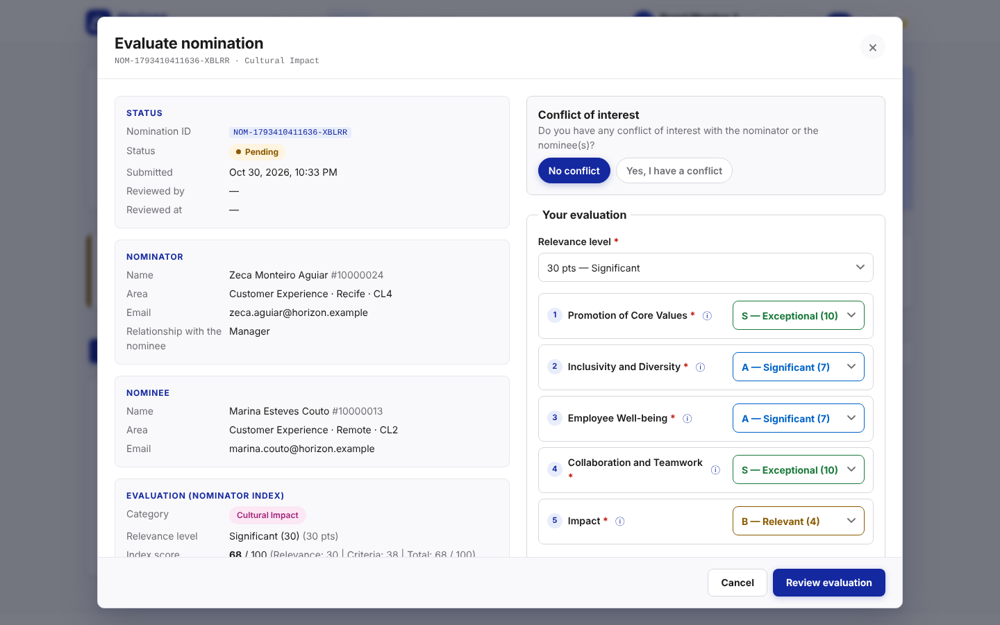
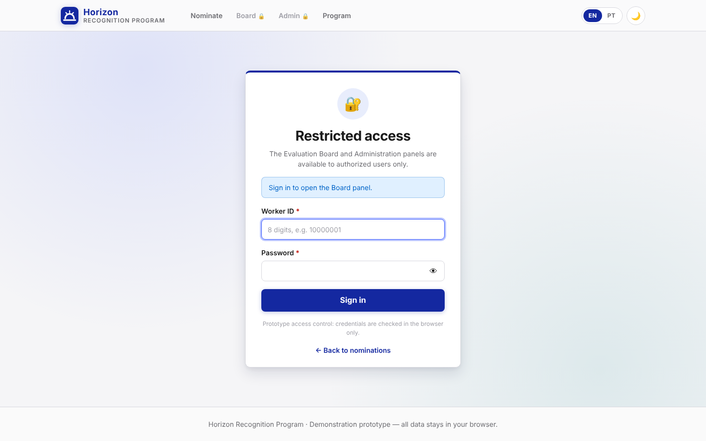
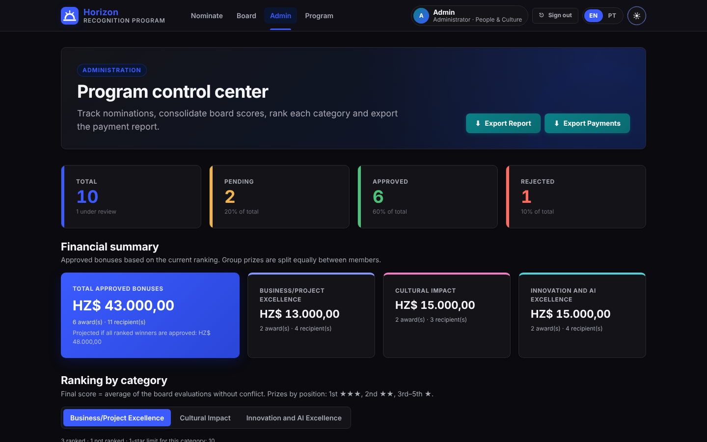
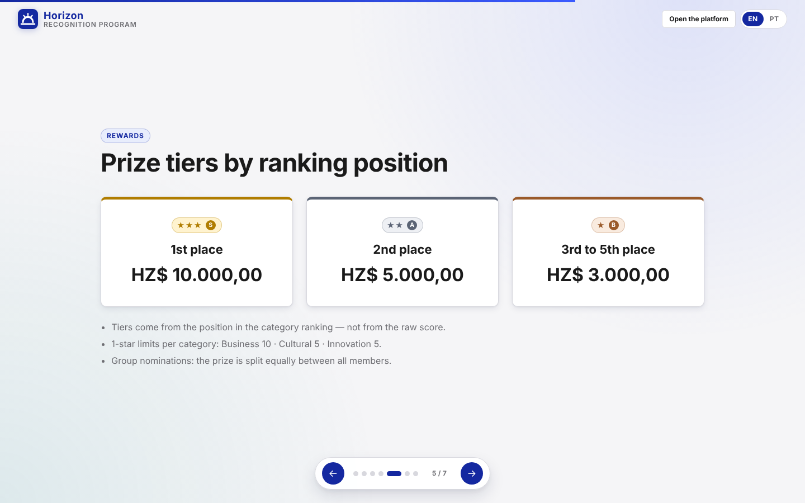

# Horizon Recognition Program

[🇧🇷 Português](README.pt-BR.md) | 🇺🇸 English

Static prototype of an **employee awards and recognition platform** for the fictitious company *Horizon*. It has three linked panels (nomination form, evaluation board and administration) and a slide presentation. Everything runs in the browser, with no backend, and data is saved in `localStorage`.

> Demo prototype: all people, IDs and e-mails are fictitious (`@horizon.example`). No data leaves the browser.

**Built with AI.** See [docs/AI-WORKFLOW.md](docs/AI-WORKFLOW.md) for how the project was specified, planned, tested and reviewed.

| Nomination form with live score | Admin: financial summary and ranking |
|---|---|
|  |  |
| **Board evaluation** | **Login (Board / Admin)** |
|  |  |
| **Dark mode** | **Program presentation** |
|  |  |

---

## How to use

1. Open `index.html` in a modern browser (Chrome, Edge, Firefox or Safari). No build or server is needed.
   - Optional: serve the folder locally with `python -m http.server` and open `http://localhost:8000`.
2. On the **Nominate** page, type an ID from the directory (e.g. `10000005`) to autofill the details, or click **Fill with example**.
3. **Board** and **Admin** require login (see [Access control](#access-control)). On the **Board** page, evaluate the nominations. To simulate several evaluators, sign out and sign in with another board ID.
4. On the **Admin** page, follow the dashboard, ranking and financial summary, change statuses and export the spreadsheets.
   - **Load demo data** adds 10 sample nominations with board evaluations, so you can see the full ranking right away.
5. `presentation.html` explains the Program in slides. Navigate with ← →, the buttons or swipe.

### Publish on GitHub Pages

The project is a static site, so GitHub Pages can host it for free:

1. Push the repository to GitHub.
2. Open **Settings → Pages**. Under *Build and deployment*, choose **Deploy from a branch**, then branch `main` and folder `/ (root)`.
3. After a minute the site is live at `https://<your-user>.github.io/<repository-name>/`. Add that link to the top of this README.

The `.nojekyll` file tells GitHub Pages to serve the files as they are.

Spreadsheet import/export (admin) loads **SheetJS 0.20.1** and **ExcelJS 4.4.0** from a CDN, so it needs an internet connection. Everything else works offline.

---

## Structure

```
horizon-recognition-program/
├── index.html            # Nomination form (main page)
├── board.html            # Evaluation Board panel
├── admin.html            # Administration panel
├── presentation.html     # Program presentation (HTML slides, light theme)
├── login.html            # Sign-in page for the Board and Admin panels
├── README.md
├── CHANGELOG.md
├── LICENSE               # MIT
├── package.json          # Only for running the tests (npm is not needed for the app)
├── package-lock.json
├── jest.config.js
├── .gitignore
├── .nojekyll             # GitHub Pages: serve files as they are
├── .github/workflows/
│   └── tests.yml         # CI: runs the Jest tests on every push / pull request
├── docs/
│   ├── AI-WORKFLOW.md    # How the project was built with AI
│   └── screenshots/
├── src/
│   ├── styles.css        # Design system (tokens, dark mode, components, responsive)
│   ├── core.js           # Shared business rules + storage + UI helpers (UMD: browser and Node)
│   ├── auth.js           # Access control: credentials, session, page guard (UMD)
│   ├── login.js          # Login page logic
│   ├── script.js         # Nomination form logic
│   ├── board.js          # Evaluation board logic
│   ├── admin.js          # Administration logic
│   ├── translations.js   # i18n EN/PT-BR (502 keys per language) + I18n helper
│   ├── theme.js          # Light/dark theme (header toggle, persisted)
│   └── workers_data.js   # Fictitious workers directory (30 seed records) + override
└── tests/
    ├── auth.test.js
    ├── scoring.test.js
    ├── self-nomination.test.js
    ├── prize.test.js
    └── validation.test.js
```

**About `src/core.js`:** this file was added to the requested structure on purpose. The three panels and the Jest tests share the same rules (scoring, ranking, prizes, validation). Keeping them in one pure module means the tests check the exact code the UI runs, and the rules are never duplicated.

### localStorage keys

| Key | Content |
|---|---|
| `hr_nominations` | Array of nominations (shared by the 3 panels) |
| `hr_workers_updated` | `{ updatedAt, source, workers[] }`: directory uploaded by the admin |
| `hr_language` | `en` \| `pt` |
| `hr_theme` | `light` \| `dark` |
| `hr_my_nominations` | IDs of nominations sent from this browser ("My Nominations") |
| `hr_session` | `{ id, name, area, role, loginAt, expiresAt }`: current login (8 h) |
| `hr_login_attempts` | `{ count, lockedUntil }`: failed-login counter and lockout |

All keys use the `hr_` prefix to avoid collisions. Changes made in one tab show up in the others (`storage` event).

---

## Data model

```js
NOMINATION = {
  id: "NOM-<timestamp>-<random>",
  type: "individual" | "grupo",
  selfNomination: boolean,                                      // true = the nominator nominated themselves
  nominator: { id, name, area, location, cl, email, relationship }, // relationship "self" in self-nominations
  nominee:   { id, name, area, location, cl, email } | null,   // individual
  group:     [ { id, name, area, location, cl, email }, ... ],  // group (1+)
  category:  "business" | "cultural" | "innovation",
  criteria:  { <criterion_id>: "S" | "A" | "B" },               // 5 criteria
  relevance: "15" | "30" | "50",
  score:     { relevance, criteria, total },
  title, description, evidence,
  attachments: [ { name, size, type } ],                          // metadata only
  status: "Pending" | "Under Review" | "Approved" | "Rejected",
  reviewedBy: string | null, reviewedAt: ISO | null,
  createdAt: ISO,
  boardEvaluations: [
    { evaluatorId, evaluatorName, scores: { relevance, criteria, total } | null,
      selections, comments, declaredConflict, conflictReason, conflictNotes, evaluatedAt }
  ]
}
```

Authorized users are listed in `src/auth.js`: `ADMIN { id: "00000001", name: "Admin", area: "People & Culture" }`, `BOARD { id: "00000002", name: "Board Member", area: "R&D Division" }`, plus two extra evaluators (`00000003`, `00000004`) so the demo can show several evaluations and the conflict-of-interest rule.

---

## Access control

The Board and Admin panels require **an authorized ID + the generic password of the profile**. The nomination page and the presentation stay public.

| Profile | Authorized IDs | Demo password |
|---|---|---|
| Admin | `00000001` | `Horizon@Admin2026` |
| Board | `00000002`, `00000003`, `00000004` | `Horizon@Banca2026` |

- **One password per profile.** Only the SHA-256 hash of each password is kept in `src/auth.js` (`AUTH_CONFIG`). To change a password, replace the hash.
- **Access matrix:** Admin → `admin.html` (full) and `board.html` (**read-only**: sees every nomination and its evaluations, cannot evaluate; the write path is also blocked in code). Board → `board.html` only; opening `admin.html` shows "profile not authorized" on the login page.
- **Guard:** `auth.js` runs in the `<head>` of protected pages and redirects to `login.html?next=…` before the page is painted. The session is re-checked every 30 s, on focus and when another tab signs out, and again before every save.
- **Session:** 8 hours, kept across tabs and browser restarts, until it expires or the user clicks **Sign out**.
- **Login rules:** 8-digit ID; the error is always generic ("Invalid ID or password"), so it never reveals which IDs exist; 5 consecutive failures lock the login for 1 minute; redirects only accept whitelisted pages (no open redirect).
- The evaluator identity on the Board and the `reviewedBy` field on the Admin come from the logged-in user.

> ⚠️ This is **prototype-grade access control, not security.** Everything runs in the browser, so anyone with the source code or access to `localStorage` can bypass it. Production needs server-side authentication (see the roadmap).

---

## Business rules

### Categories (5 criteria each)
| Category | Criteria |
|---|---|
| Business/Project Excellence | Strategic Alignment · Execution · Innovation · Impact · Collaboration |
| Cultural Impact | Promotion of Core Values · Inclusivity and Diversity · Employee Well-being · Collaboration and Teamwork · Impact |
| Innovation and AI Excellence | Innovation · Technical Expertise · Impact · Collaboration · Strategic Thinking |

### Scoring
- Relevance: **15** (Relevant: one team/project) · **30** (Significant: several areas) · **50** (Exceptional: whole organization).
- Each criterion: **S = 10**, **A = 7**, **B = 4**.
- **Total = relevance + sum of the 5 criteria**, maximum **100**. The score updates live on every selection.
- **Eligibility:** total < 60 means not eligible. On *Confirm and Submit*, a rejection modal explains the minimum, the form is cleared and **nothing is saved**.

> Note: with S/A/B = 10/7/4 over 5 criteria, the criteria sum is always `20 + 3k`. So some totals, such as 55, cannot be reached from the form (the closest values are 53 and 56). The rule (< 60) is tested with 55 directly and with the values the form can actually produce.

### Consolidated score (admin)
- `indexScore` = the nominator's score (reference only).
- `boardAverage` = average of relevance/criteria/total over **every evaluation with no declared conflict**.
- `finalScore = boardAverage`. The index score never counts toward the final score.
- One evaluation per board member per nomination.

### Ranking and prizes
- Each category is sorted by `finalScore.total` (descending). Ties are broken by criteria average, then number of valid evaluations, then oldest first.
- Only nominations that are **not rejected**, have **at least one valid evaluation** and a **final score ≥ 60** are ranked. The rest are listed as "Not ranked" with the reason.
- Tier by **position**: 1st → **S ★★★ HZ$ 10.000,00** · 2nd → **A ★★ HZ$ 5.000,00** · 3rd to 5th → **B ★ HZ$ 3.000,00** · others → no prize.
- 1-star limits per category: Business 10 · Cultural 5 · Innovation 5. These limits act as a **cap** on tier B. With the current values the 3rd–5th window is the binding rule (at most 3 B awards). The limit is configurable and enforced by `determinePrizeTier`, and it is covered by tests with lower limits.
- **Group:** the prize is split **equally** between members (e.g. S ÷ 3 = HZ$ 3.333,33 each).
- **Financial summary** and **Export Payments** only include **Approved** nominations that have a tier.

### Self-nomination
- Optional. The form asks **"Who is this nomination for?"**: *Someone else* (default) or *Myself*.
- *Myself* makes the nomination **individual only** (Group is disabled). The nominee fields are **locked and mirror the nominator** in real time. The "Relationship" field is hidden and stored as `self`.
- Validation: in a self-nomination the nominee must match the nominator exactly. Using your own ID without choosing *Myself* shows an error with a hint. The nominator still cannot be a member of a group they nominate.
- Scoring, eligibility, ranking and prizes are the same as for any other nomination.
- Self-nominations carry a **"Self-nomination" badge** in the review, My Nominations, the Board and the Admin. The Admin list has an **Origin** filter, and the report export has a "Self-nomination" column.
- Records created before v1.2, without the field, are read as `selfNomination: false`.

### Status workflow
The nominator creates the nomination as `Pending`. The admin moves it to `Under Review`, `Approved` or `Rejected`, one at a time or in bulk with checkboxes, always after a confirmation modal. `reviewedBy` and `reviewedAt` are always recorded.

### Validation
Required fields; 8-digit IDs; valid e-mail; relationship from the list (except in self-nominations); own ID only through the *Myself* option, individual only (never as a group member); no duplicate members; all 5 criteria; title ≤ 120; description ≥ 30; evidence ≥ 20; up to 5 attachments of 10 MB (pdf, images, Office, txt, csv). On the board: conflict yes/no is required. If yes, a reason and notes are required and scoring is turned off. If no, relevance, the 5 criteria and comments (10–1000 characters) are required.

---

## Features by panel

**Nomination (`index.html`)**: ID autofill (with a `datalist` for suggestions), optional self-nomination (nominee mirrors the nominator), individual or group (+ Add Member / remove), criteria built for the chosen category with S/A/B selects and tooltips, live score panel (highlighted when ≥ 60), attachments by drag-and-drop or click, review modal, rejection modal, success modal, and "My Nominations" with filters by category and status.

**Board (`board.html`)**: mock identity in the header, Pending Evaluations / My Evaluations tabs, full details modal, conflict-of-interest section, evaluation with live score, review and confirmation, and a read-only view of submitted evaluations.

**Admin (`admin.html`)**: 4 live stat cards, financial summary (total and per category, plus a projection), ranking per category (index score, final score, number of evaluations, conflicts, star badge, prize per member), nomination list with filters (category, status, type, origin) and bulk actions, full details modal (board evaluations and consolidated score), workers directory upload (.xlsx/.csv: checks columns, pads numeric IDs, skips invalid rows), template download, restore default directory, styled exports (blue header, automatic column widths, frozen header, filters, HZ$ currency format), toasts for every action, and demo tools.

**Cross-cutting**: EN/PT-BR i18n (`data-i18n`, persisted), light/dark theme (`body.dark-mode`, persisted, follows the system preference on the first visit), responsive layout (breakpoints at 1024px and 640px), basic accessibility (skip link, aria attributes, keyboard focus, Esc closes modals), and reduced-motion support. The presentation always uses the light theme, as specified, and has its own language toggle.

---

## Tests

Pure Jest tests (no DOM) over `src/core.js`:

```bash
npm install
npm test              # 120 tests: scoring, prizes/ranking, validation, access control, self-nomination
npm run test:coverage
```

The same tests run automatically on GitHub (Node 20 and 22) through `.github/workflows/tests.yml`. The result shows in the **Actions** tab and on every pull request.

| File | Covers |
|---|---|
| `auth.test.js` | Password hash per profile, authorized IDs, generic errors, 5-attempt lockout, 8-hour session, access matrix, admin read-only, safe redirects |
| `scoring.test.js` | Relevance, criteria, total, 100 maximum, 60 eligibility, reachable values |
| `prize.test.js` | Tier by position (1→S, 2→A, 3–5→B, >5→null), amounts, group split, 1-star limits, conflict-free average, ranking, payments, financial summary, status audit |
| `validation.test.js` | Required fields, e-mail, IDs, group members, attachments, board evaluation, spreadsheet parsing |
| `self-nomination.test.js` | Valid self-nomination, nominee = nominator, individual only, own-ID hint, stored flag and `self` relationship, legacy records, same ranking and prizes |

### Manual QA checklist (validated end to end in headless Chrome)
1. Individual nomination: autofill → criteria → review → submit → admin approves ✔
2. Group of 3 in 1st place → HZ$ 3.333,33 per member ✔
3. Score below 60 → rejection modal, nothing saved, form cleared ✔
4. 2 normal evaluations + 1 conflict → final score uses only the 2 ✔
5. Workers spreadsheet upload → autofill uses the new data ✔
6. Export Payments with the correct amounts per tier and position ✔
7. Language and theme toggles persist across all pages ✔
8. `hr_nominations` is consistent across the 3 pages ✔
9. Login: redirect without session, generic error, lockout, profile denied, expired session, logout, admin read-only on the Board ✔
10. Self-nomination: nominee mirrors the nominator, group disabled, saved with the flag, badge on every panel, Origin filter, export column ✔

---

## Production roadmap

1. **Backend and database:** REST/GraphQL API (e.g. Node + PostgreSQL) with transactions for evaluations and status changes. Real attachment storage (object storage + antivirus).
2. **Authentication and roles:** replace the browser-side login with corporate SSO (OIDC/SAML) or server-side sessions (individual passwords, hashing with salt, HttpOnly cookies), real admin/board/employee roles, and a server-side check for "one evaluation per member".
3. **Audit:** immutable status history (who, when, before/after) instead of only `reviewedBy/reviewedAt`.
4. **Directory integration:** sync with the HR system instead of spreadsheet uploads.
5. **Cycles and deadlines:** configurable nomination and evaluation windows, with the limits and amounts set per cycle.
6. **Notifications:** e-mail or chat alerts for nominators, the board and winners.
7. **Fairness:** anonymous evaluation, a minimum number of evaluations per nomination, and outlier detection.
8. **Quality:** E2E tests (Playwright) in CI, linting, WCAG 2.2 AA accessibility checks, and observability.
9. **Payroll export:** integration with the payment system and approval by finance.
