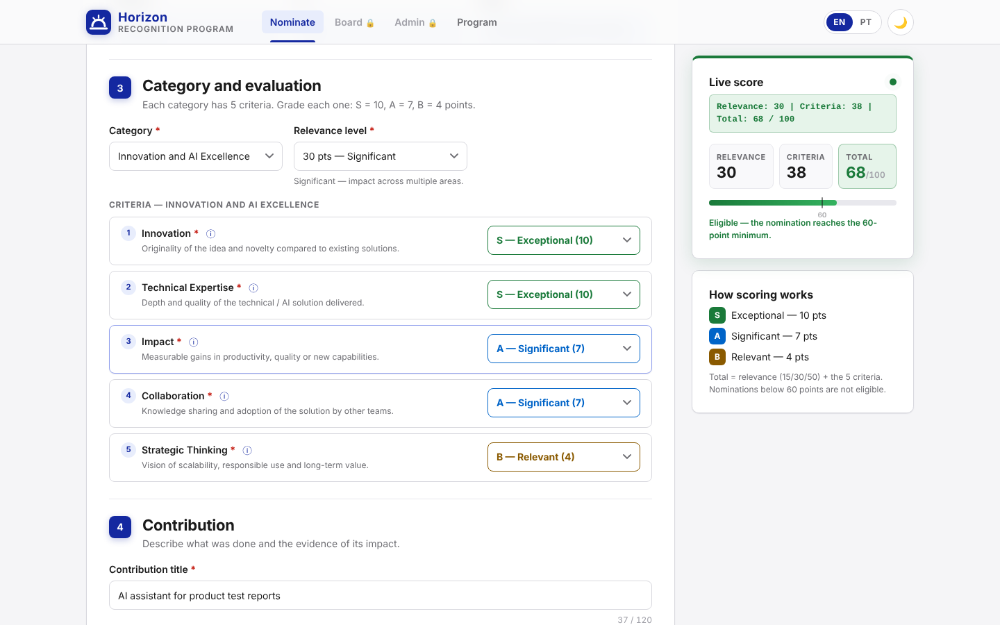
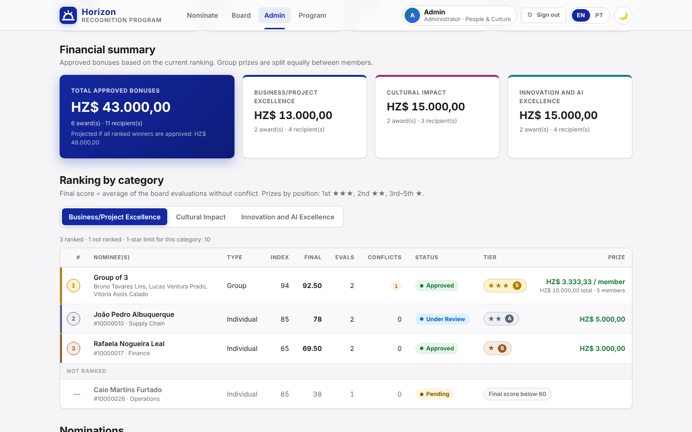
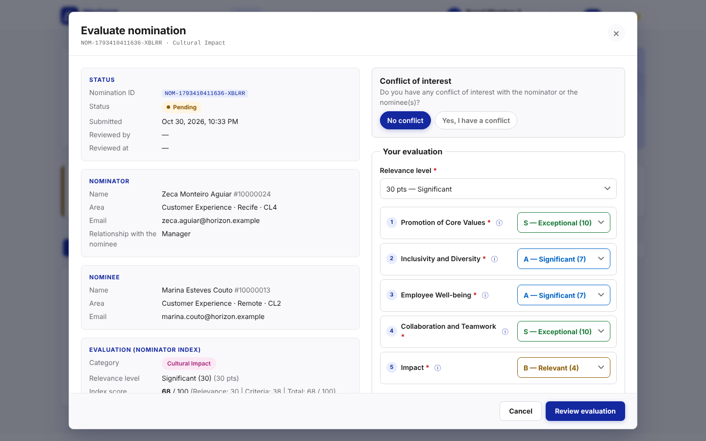
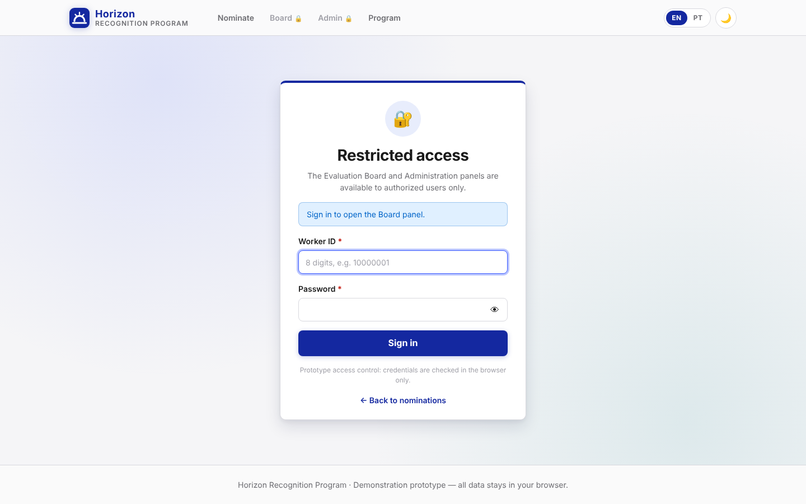
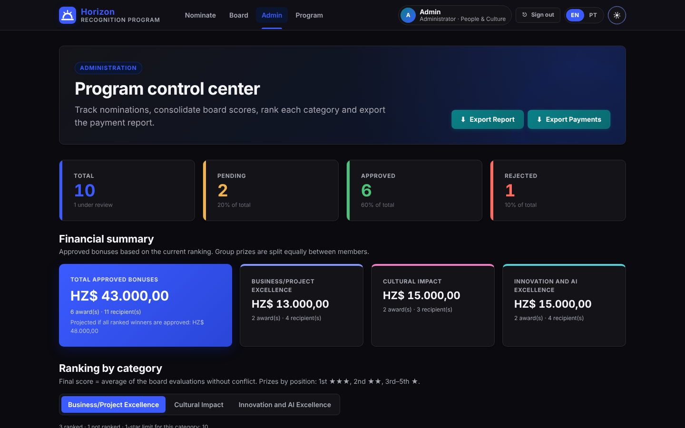
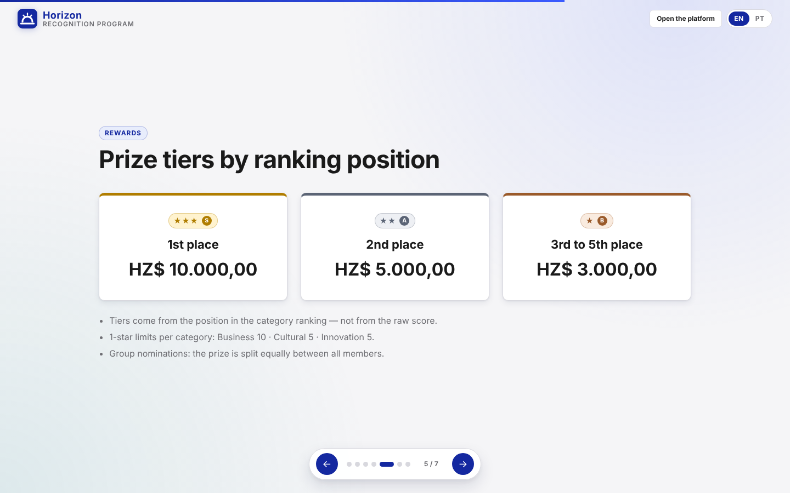

# Horizon Recognition Program

🇧🇷 Português | [🇺🇸 English](README.md)

Protótipo estático de uma **plataforma de premiação e reconhecimento de colaboradores** para a empresa fictícia *Horizon*. Tem três painéis integrados (formulário de indicação, banca avaliadora e administração) e uma apresentação em slides. Tudo roda no navegador, sem backend, e os dados ficam salvos no `localStorage`.

> Protótipo de demonstração: todas as pessoas, IDs e e-mails são fictícios (`@horizon.example`). Nenhum dado sai do navegador.

**Feito com IA.** Veja em [docs/AI-WORKFLOW.md](docs/AI-WORKFLOW.md) como o projeto foi especificado, planejado, testado e revisado.

| Formulário de indicação com pontuação ao vivo | Admin: resumo financeiro e ranking |
|---|---|
|  |  |
| **Avaliação da banca** | **Login (Banca / Admin)** |
|  |  |
| **Modo escuro** | **Apresentação do programa** |
|  |  |

---

## Como usar

1. Abra o `index.html` em um navegador moderno (Chrome, Edge, Firefox ou Safari). Não precisa de build nem de servidor.
   - Opcional: sirva a pasta localmente com `python -m http.server` e abra `http://localhost:8000`.
2. Na página **Indicar**, digite um ID do cadastro (ex.: `10000005`) para preencher os dados automaticamente, ou clique em **Preencher com exemplo**.
3. **Banca** e **Admin** exigem login (veja [Controle de acesso](#controle-de-acesso)). Na página da **Banca**, avalie as indicações. Para simular vários avaliadores, saia e entre com outro ID da banca.
4. Na página **Admin**, acompanhe o painel, o ranking e o resumo financeiro, altere status e exporte as planilhas.
   - **Carregar dados de demonstração** adiciona 10 indicações de exemplo já avaliadas pela banca, para ver o ranking completo na hora.
5. O `presentation.html` explica o Programa em slides. Navegue com ← →, pelos botões ou deslizando.

### Publicar no GitHub Pages

O projeto é um site estático, então o GitHub Pages hospeda de graça:

1. Envie o repositório para o GitHub.
2. Abra **Settings → Pages**. Em *Build and deployment*, escolha **Deploy from a branch**, depois a branch `main` e a pasta `/ (root)`.
3. Depois de um minuto o site fica no ar em `https://<seu-usuario>.github.io/<nome-do-repositorio>/`. Coloque esse link no topo deste README.

O arquivo `.nojekyll` faz o GitHub Pages servir os arquivos como estão.

A importação e exportação de planilhas (admin) carrega **SheetJS 0.20.1** e **ExcelJS 4.4.0** de um CDN, então precisa de internet. Todo o resto funciona offline.

---

## Estrutura

```
horizon-recognition-program/
├── index.html            # Formulário de indicação (página principal)
├── board.html            # Painel da Banca Avaliadora
├── admin.html            # Painel de Administração
├── presentation.html     # Apresentação do Programa (slides em HTML, tema claro)
├── login.html            # Página de login dos painéis Banca e Admin
├── README.md             # Versão em inglês deste arquivo
├── README.pt-BR.md
├── CHANGELOG.md
├── LICENSE               # MIT
├── package.json          # Só para rodar os testes (o app não precisa de npm)
├── package-lock.json
├── jest.config.js
├── .gitignore
├── .nojekyll             # GitHub Pages: servir os arquivos como estão
├── .github/workflows/
│   └── tests.yml         # CI: roda os testes Jest a cada push / pull request
├── docs/
│   ├── AI-WORKFLOW.md    # Como o projeto foi feito com IA
│   └── screenshots/
├── src/
│   ├── styles.css        # Design system (tokens, modo escuro, componentes, responsivo)
│   ├── core.js           # Regras de negócio compartilhadas + armazenamento + helpers de UI (UMD: navegador e Node)
│   ├── auth.js           # Controle de acesso: credenciais, sessão, proteção de páginas (UMD)
│   ├── login.js          # Lógica da página de login
│   ├── script.js         # Lógica do formulário de indicação
│   ├── board.js          # Lógica da banca avaliadora
│   ├── admin.js          # Lógica da administração
│   ├── translations.js   # i18n EN/PT-BR (502 chaves por idioma) + helper I18n
│   ├── theme.js          # Tema claro/escuro (botão no cabeçalho, persistido)
│   └── workers_data.js   # Cadastro fictício de colaboradores (30 registros iniciais) + substituição
└── tests/
    ├── auth.test.js
    ├── scoring.test.js
    ├── self-nomination.test.js
    ├── prize.test.js
    └── validation.test.js
```

**Sobre o `src/core.js`:** este arquivo foi adicionado de propósito à estrutura pedida. Os três painéis e os testes Jest usam as mesmas regras (pontuação, ranking, prêmios, validação). Mantê-las num único módulo puro faz os testes verificarem exatamente o código que a interface executa, e as regras nunca ficam duplicadas.

### Chaves do localStorage

| Chave | Conteúdo |
|---|---|
| `hr_nominations` | Array de indicações (compartilhado pelos 3 painéis) |
| `hr_workers_updated` | `{ updatedAt, source, workers[] }`: cadastro enviado pelo admin |
| `hr_language` | `en` \| `pt` |
| `hr_theme` | `light` \| `dark` |
| `hr_my_nominations` | IDs das indicações enviadas deste navegador ("Minhas Indicações") |
| `hr_session` | `{ id, name, area, role, loginAt, expiresAt }`: login atual (8 h) |
| `hr_login_attempts` | `{ count, lockedUntil }`: contador de logins com erro e bloqueio |

Todas as chaves usam o prefixo `hr_` para evitar colisões. Mudanças feitas em uma aba aparecem nas outras (evento `storage`).

---

## Modelo de dados

```js
NOMINATION = {
  id: "NOM-<timestamp>-<random>",
  type: "individual" | "grupo",
  selfNomination: boolean,                                      // true = o indicador indicou a si mesmo
  nominator: { id, name, area, location, cl, email, relationship }, // relationship "self" na autoindicação
  nominee:   { id, name, area, location, cl, email } | null,   // individual
  group:     [ { id, name, area, location, cl, email }, ... ],  // grupo (1+)
  category:  "business" | "cultural" | "innovation",
  criteria:  { <criterion_id>: "S" | "A" | "B" },               // 5 critérios
  relevance: "15" | "30" | "50",
  score:     { relevance, criteria, total },
  title, description, evidence,
  attachments: [ { name, size, type } ],                          // só metadados
  status: "Pending" | "Under Review" | "Approved" | "Rejected",
  reviewedBy: string | null, reviewedAt: ISO | null,
  createdAt: ISO,
  boardEvaluations: [
    { evaluatorId, evaluatorName, scores: { relevance, criteria, total } | null,
      selections, comments, declaredConflict, conflictReason, conflictNotes, evaluatedAt }
  ]
}
```

Os usuários autorizados ficam em `src/auth.js`: `ADMIN { id: "00000001", name: "Admin", area: "People & Culture" }`, `BOARD { id: "00000002", name: "Board Member", area: "R&D Division" }` e mais dois avaliadores (`00000003`, `00000004`), para a demonstração mostrar várias avaliações e a regra de conflito de interesse.

---

## Controle de acesso

Os painéis Banca e Admin exigem **um ID autorizado + a senha genérica do perfil**. A página de indicação e a apresentação continuam públicas.

| Perfil | IDs autorizados | Senha de demonstração |
|---|---|---|
| Admin | `00000001` | `Horizon@Admin2026` |
| Banca | `00000002`, `00000003`, `00000004` | `Horizon@Banca2026` |

- **Uma senha por perfil.** Só o hash SHA-256 de cada senha fica em `src/auth.js` (`AUTH_CONFIG`). Para trocar uma senha, substitua o hash.
- **Matriz de acesso:** Admin → `admin.html` (completo) e `board.html` (**somente leitura**: vê todas as indicações e avaliações, mas não avalia; a gravação também é bloqueada no código). Banca → só `board.html`; abrir o `admin.html` mostra "perfil não autorizado" na página de login.
- **Proteção:** o `auth.js` roda no `<head>` das páginas protegidas e redireciona para `login.html?next=…` antes de a página aparecer. A sessão é verificada de novo a cada 30 s, ao voltar o foco, quando outra aba sai, e antes de cada gravação.
- **Sessão:** 8 horas, mantida entre abas e ao reabrir o navegador, até expirar ou o usuário clicar em **Sair**.
- **Regras de login:** ID de 8 dígitos; o erro é sempre genérico ("ID ou senha inválidos"), para nunca revelar quais IDs existem; 5 erros seguidos bloqueiam o login por 1 minuto; os redirecionamentos só aceitam páginas de uma lista permitida (sem open redirect).
- A identidade do avaliador na Banca e o campo `reviewedBy` no Admin vêm do usuário logado.

> ⚠️ Este é um **controle de acesso de protótipo, não segurança.** Tudo roda no navegador, então quem tiver o código-fonte ou acesso ao `localStorage` consegue contornar. Em produção é preciso autenticação no servidor (veja o roadmap).

---

## Regras de negócio

### Categorias (5 critérios cada)
| Categoria | Critérios |
|---|---|
| Excelência em Negócios/Projetos | Alinhamento Estratégico · Execução · Inovação · Impacto · Colaboração |
| Impacto Cultural | Promoção dos Valores · Inclusão e Diversidade · Bem-estar dos Colaboradores · Colaboração e Trabalho em Equipe · Impacto |
| Excelência em Inovação e IA | Inovação · Conhecimento Técnico · Impacto · Colaboração · Pensamento Estratégico |

### Pontuação
- Relevância: **15** (Relevante: um time/projeto) · **30** (Significativa: várias áreas) · **50** (Excepcional: a organização inteira).
- Cada critério: **S = 10**, **A = 7**, **B = 4**.
- **Total = relevância + soma dos 5 critérios**, máximo **100**. A pontuação é atualizada ao vivo a cada seleção.
- **Elegibilidade:** total < 60 não é elegível. Em *Confirmar e Enviar*, um modal de recusa explica o mínimo, o formulário é limpo e **nada é salvo**.

> Observação: com S/A/B = 10/7/4 em 5 critérios, a soma dos critérios é sempre `20 + 3k`. Por isso alguns totais, como 55, não podem ser obtidos pelo formulário (os mais próximos são 53 e 56). A regra (< 60) é testada com 55 diretamente e com os valores que o formulário realmente produz.

### Pontuação consolidada (admin)
- `indexScore` = pontuação dada por quem indicou (só referência).
- `boardAverage` = média de relevância/critérios/total de **todas as avaliações sem conflito declarado**.
- `finalScore = boardAverage`. A pontuação de quem indicou nunca entra na nota final.
- Uma avaliação por membro da banca por indicação.

### Ranking e prêmios
- Cada categoria é ordenada por `finalScore.total` (decrescente). Empates são resolvidos pela média dos critérios, depois pelo número de avaliações válidas, depois pela mais antiga.
- Só entram no ranking indicações **não recusadas**, com **pelo menos uma avaliação válida** e **nota final ≥ 60**. As demais aparecem como "Fora do ranking", com o motivo.
- Faixa pela **posição**: 1º → **S ★★★ HZ$ 10.000,00** · 2º → **A ★★ HZ$ 5.000,00** · 3º ao 5º → **B ★ HZ$ 3.000,00** · demais → sem prêmio.
- Limites de 1 estrela por categoria: Negócios 10 · Cultural 5 · Inovação 5. Esses limites funcionam como **teto** da faixa B. Com os valores atuais, a janela 3º–5º é a regra que prevalece (no máximo 3 prêmios B). O limite é configurável, aplicado por `determinePrizeTier` e coberto por testes com limites menores.
- **Grupo:** o prêmio é dividido **igualmente** entre os membros (ex.: S ÷ 3 = HZ$ 3.333,33 cada).
- O **resumo financeiro** e o **Exportar Pagamentos** só incluem indicações **Aprovadas** que tenham faixa.

### Autoindicação
- É opcional. O formulário pergunta **"Para quem é a indicação?"**: *Outra pessoa* (padrão) ou *Eu mesmo(a)*.
- *Eu mesmo(a)* deixa a indicação **apenas individual** (a opção Grupo fica desativada). Os campos do indicado ficam **travados e espelham o indicador** em tempo real. O campo "Relação" some e é gravado como `self`.
- Validação: na autoindicação, o indicado precisa ser exatamente o indicador. Quem usa o próprio ID sem escolher *Eu mesmo(a)* vê um erro com a dica. O indicador continua sem poder ser membro de um grupo que ele indica.
- Pontuação, elegibilidade, ranking e prêmios são os mesmos de qualquer indicação.
- Autoindicações levam o **selo "Autoindicação"** na revisão, em Minhas Indicações, na Banca e no Admin. A lista do Admin tem o filtro **Origem**, e o relatório exportado tem a coluna "Autoindicação".
- Registros criados antes da v1.2, sem o campo, são lidos como `selfNomination: false`.

### Fluxo de status
Quem indica cria a indicação como `Pending` (Pendente). O admin muda para `Under Review` (Em Análise), `Approved` (Aprovada) ou `Rejected` (Recusada), uma por vez ou em lote com checkboxes, sempre depois de um modal de confirmação. `reviewedBy` e `reviewedAt` são sempre registrados.

### Validação
Campos obrigatórios; IDs de 8 dígitos; e-mail válido; relação escolhida da lista (exceto na autoindicação); o próprio ID só pela opção *Eu mesmo(a)*, apenas individual (nunca como membro de grupo); sem membros repetidos; os 5 critérios; título ≤ 120; descrição ≥ 30; evidências ≥ 20; até 5 anexos de 10 MB (pdf, imagens, Office, txt, csv). Na banca: conflito sim/não é obrigatório. Se sim, motivo e observações são obrigatórios e a pontuação é desativada. Se não, relevância, os 5 critérios e comentários (10–1000 caracteres) são obrigatórios.

---

## Funcionalidades por painel

**Indicação (`index.html`)**: preenchimento automático pelo ID (com `datalist` de sugestões), autoindicação opcional (o indicado espelha o indicador), individual ou grupo (+ Adicionar Membro / remover), critérios montados para a categoria escolhida com selects S/A/B e tooltips, painel de pontuação ao vivo (destacado quando ≥ 60), anexos por arrastar e soltar ou clique, modal de revisão, modal de recusa, modal de sucesso e "Minhas Indicações" com filtros por categoria e status.

**Banca (`board.html`)**: identidade no cabeçalho, abas Avaliações Pendentes / Minhas Avaliações, modal com todos os detalhes, seção de conflito de interesse, avaliação com pontuação ao vivo, revisão e confirmação, e visualização somente leitura das avaliações enviadas.

**Admin (`admin.html`)**: 4 cards de estatísticas ao vivo, resumo financeiro (total e por categoria, com projeção), ranking por categoria (nota de quem indicou, nota final, número de avaliações, conflitos, selo de estrelas, prêmio por membro), lista de indicações com filtros (categoria, status, tipo, origem) e ações em lote, modal com todos os detalhes (avaliações da banca e nota consolidada), envio do cadastro de colaboradores (.xlsx/.csv: confere as colunas, completa IDs numéricos com zeros, ignora linhas inválidas), download do modelo, restaurar o cadastro padrão, exportações formatadas (cabeçalho azul, largura automática das colunas, cabeçalho congelado, filtros, formato de moeda HZ$), avisos (toasts) para cada ação e ferramentas de demonstração.

**Em todas as páginas**: i18n EN/PT-BR (`data-i18n`, persistido), tema claro/escuro (`body.dark-mode`, persistido, segue a preferência do sistema na primeira visita), layout responsivo (breakpoints em 1024px e 640px), acessibilidade básica (skip link, atributos aria, foco pelo teclado, Esc fecha modais) e suporte a movimento reduzido. A apresentação usa sempre o tema claro, como especificado, e tem seu próprio botão de idioma.

---

## Testes

Testes Jest puros (sem DOM) sobre o `src/core.js`:

```bash
npm install
npm test              # 120 testes: pontuação, prêmios/ranking, validação, controle de acesso, autoindicação
npm run test:coverage
```

Os mesmos testes rodam automaticamente no GitHub (Node 20 e 22) pelo `.github/workflows/tests.yml`. O resultado aparece na aba **Actions** e em cada pull request.

| Arquivo | O que cobre |
|---|---|
| `auth.test.js` | Hash de senha por perfil, IDs autorizados, erros genéricos, bloqueio após 5 tentativas, sessão de 8 horas, matriz de acesso, admin somente leitura, redirecionamentos seguros |
| `scoring.test.js` | Relevância, critérios, total, máximo de 100, elegibilidade 60, valores possíveis |
| `prize.test.js` | Faixa por posição (1→S, 2→A, 3–5→B, >5→null), valores, divisão em grupo, limites de 1 estrela, média sem conflito, ranking, pagamentos, resumo financeiro, auditoria de status |
| `validation.test.js` | Campos obrigatórios, e-mail, IDs, membros do grupo, anexos, avaliação da banca, leitura de planilhas |
| `self-nomination.test.js` | Autoindicação válida, indicado = indicador, apenas individual, dica do próprio ID, flag e relação `self` gravadas, registros antigos, mesmo ranking e prêmios |

### Checklist de QA manual (validado de ponta a ponta no Chrome headless)
1. Indicação individual: preenchimento automático → critérios → revisão → envio → admin aprova ✔
2. Grupo de 3 em 1º lugar → HZ$ 3.333,33 por membro ✔
3. Nota abaixo de 60 → modal de recusa, nada salvo, formulário limpo ✔
4. 2 avaliações normais + 1 com conflito → nota final usa só as 2 ✔
5. Envio da planilha de colaboradores → preenchimento automático usa os dados novos ✔
6. Exportar Pagamentos com os valores corretos por faixa e posição ✔
7. Idioma e tema persistem em todas as páginas ✔
8. `hr_nominations` consistente nas 3 páginas ✔
9. Login: redirecionamento sem sessão, erro genérico, bloqueio, perfil negado, sessão expirada, sair, admin somente leitura na Banca ✔
10. Autoindicação: indicado espelha o indicador, grupo desativado, gravada com a flag, selo em todos os painéis, filtro Origem, coluna no relatório ✔

---

## Roadmap para produção

1. **Backend e banco de dados:** API REST/GraphQL (ex.: Node + PostgreSQL) com transações para avaliações e mudanças de status. Armazenamento real dos anexos (object storage + antivírus).
2. **Autenticação e perfis:** trocar o login no navegador por SSO corporativo (OIDC/SAML) ou sessões no servidor (senhas individuais, hash com salt, cookies HttpOnly), perfis reais de admin/banca/colaborador e verificação no servidor de "uma avaliação por membro".
3. **Auditoria:** histórico imutável de status (quem, quando, antes/depois) em vez de só `reviewedBy/reviewedAt`.
4. **Integração com o cadastro:** sincronizar com o sistema de RH em vez de enviar planilhas.
5. **Ciclos e prazos:** janelas de indicação e avaliação configuráveis, com limites e valores definidos por ciclo.
6. **Notificações:** avisos por e-mail ou chat para quem indicou, para a banca e para os vencedores.
7. **Justiça:** avaliação anônima, número mínimo de avaliações por indicação e detecção de notas fora da curva.
8. **Qualidade:** testes E2E (Playwright) no CI, lint, verificação de acessibilidade WCAG 2.2 AA e observabilidade.
9. **Exportação para a folha de pagamento:** integração com o sistema de pagamentos e aprovação pelo financeiro.
